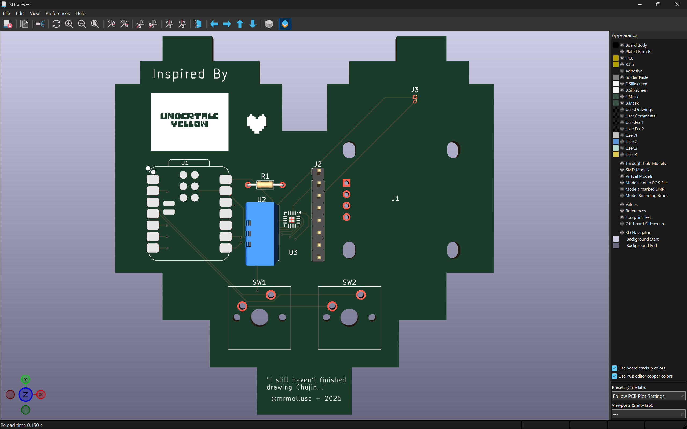

# my-first-hardware

Heartbie companion with temperature sensor, screen, XIAO ESP32 C3 processor, MAX audio chip and outemu key switches

# NOTE!!!

For viewing the BOM generated by KICAD, observe BOM.csv. For viewing the BOM created within halflife as covered by a $30 grant, observe BOM.md